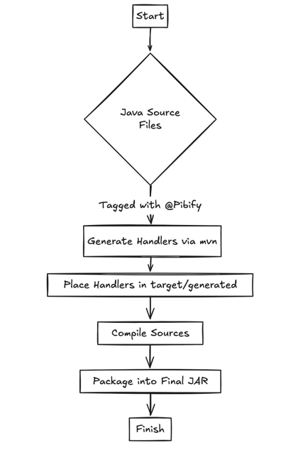

# Architecture Overview

## Modules

- `pibify-core`: runtime contracts and implementations for serialization/deserialization.
- `pibify-maven-plugin`: Maven goals for annotation and handler code generation.
- `test-environments/*`: example integrations and validation modules.

## End-to-end flow

1. Model fields are marked with `@Pibify(<index>)`.
2. `pibify-maven-plugin` scans annotated classes.
3. Plugin generates handler classes and `PibifyHandlerCache`.
4. Application code uses the generated cache to serialize/deserialize objects.
5. Framework adapters (Dropwizard/Vert.x) serve protobuf when requested (`Accept: application/proto`).

For details on code generation, see [code generator flow](codegenflow.png).

## Generated artifacts

For each annotated class:

- `<ClassName>Handler` is generated.
- Handler is registered in generated `PibifyHandlerCache`.

## Runtime behavior

- Serializer/deserializer implementations are resolved via handler cache.
- Known built-in handlers in core are used for selected generic/object cases.
- Custom handlers can be merged using multi-module cache support.

For handler details, see [Handlers.md](Handlers.md).  
For integration details, see [dropwizard.md](dropwizard.md) and [vertx.md](vertx.md).
